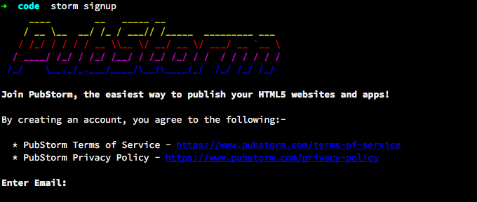

PubStorm is a free web publishing and hosting platform for HTML5 websites and applications. With PubStorm, you can get a live website or HTML5 application up and running in seconds.

To get started, you’ll need to download the PubStorm CLI. The PubStorm CLI is distributed as a node package called `storm`, so you’ll need to make sure you have [Node running on your machine first](https://nodejs.org/en/download/). Then, open a terminal/command line prompt and run:

```bash
mycomputer:~$ npm install -g pubstorm
```

<div class="alert warning">
  <strong>Note:</strong> If you get a permission denied error, you might need to run <code>sudo npm install -g pubstorm</code>
</div>

### Create Your Account

Once you’ve installed the PubStorm CLI, you’re ready to create an account. Accounts are 100% free for unlimited projects. You will need to confirm your email address by pasting a confirmation code in the terminal.

<figure>
  
</figure>

### Create Your First Project

Creating your first project is super simple. Just `cd` into the folder of the website or front-end application you want to publish to PubStorm and type:

	  mycomputer:~/websites/my_blog$ storm init

You'll be prompted with a confirmation that you want to use the current directory as the source to be built and published.

    mycomputer:~/websites/my_blog$ storm init
    Set up your PubStorm project
    Enter Project Path: [.] my_blog
    [Info] Successfully created project "my_blog".
    [Info] Saved project settings to "pubstorm.json". This file should not be deleted.

#### Project Path

`Project Path` is the location of your website's files (HTML, CSS & Javascript files). In many cases, this will be the current folder, so you can simple type `.`.

If you are using a static site builder like [Jekyll]() or [Hugo]() or [MkDocs]() you will want to enter the `_site` or `site` directory as the `Project Path`.

#### Project Name

Next, you'll need to enter a name for the project. Note that if you are not using a [custom domain](), this name will be the subdomain for your live website: `my-new-blog.pubstormapp.com`.

    mycomputer:~/websites/my_blog$ storm init
    Set up your PubStorm project
    Enter Project Path: [.]
    Enter Project Name: my-new-blog


<div class="alert warning">
  <strong>Note:</strong> Your project name cannot contain spaces since it will act as the subdomain for your project.
</div>

    mycomputer:~/websites/my_blog$ storm init
    Set up your PubStorm project
    Enter Project Path: [.]
    Enter Project Name: my-new-blog
    [Info] Successfully created project "my-new-blog".
    [Info] Saved project settings to "storm.json". This file should not be deleted.


### Publish Your Project

Once you've initialized your project directory, you can publish easily using the following command:

    mycomputer:~/websites/my_blog$ storm publish

