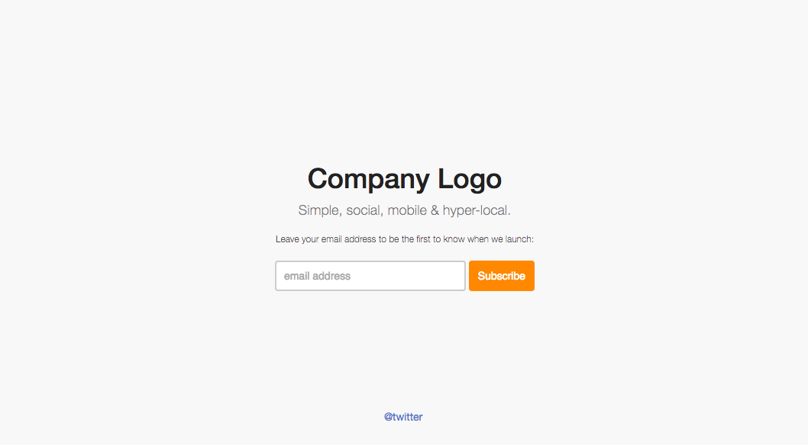
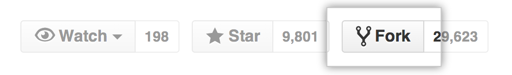
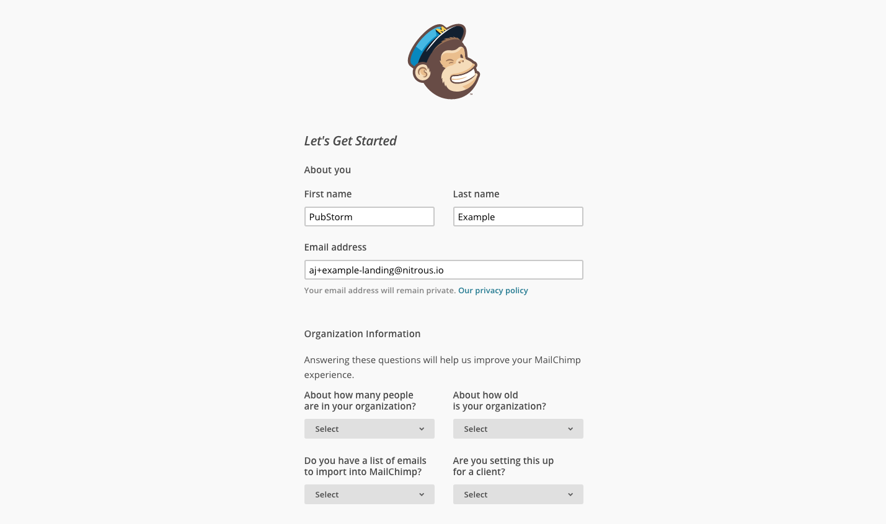
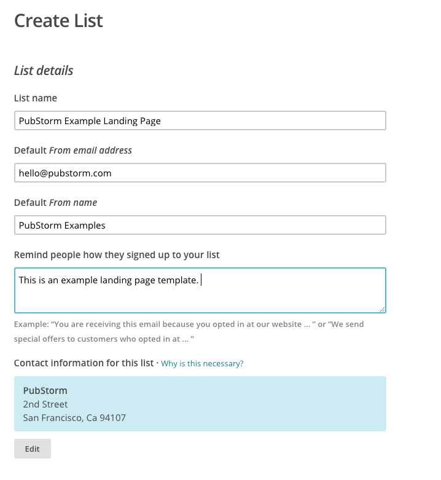
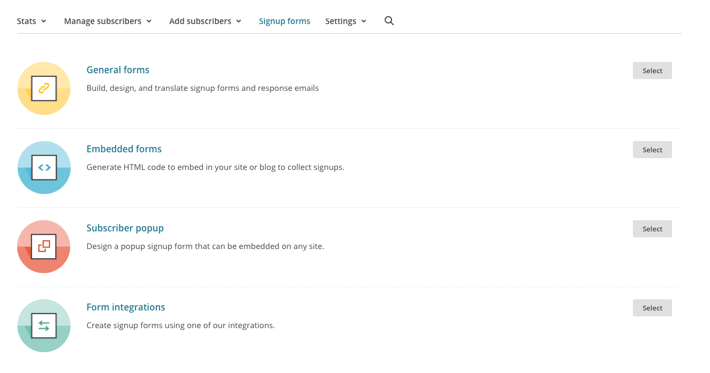
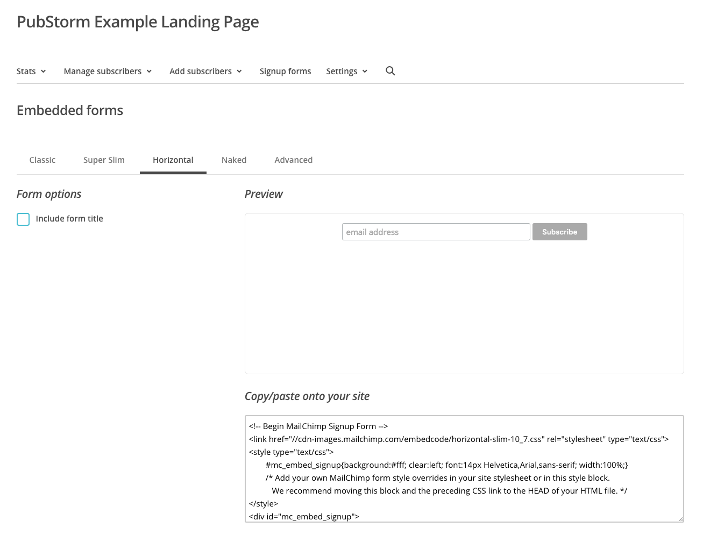

You've got a great idea for a new app. Your company is working on a new product. You're writing a new ebook.

You might not be ready to ship for a few weeks, or even months! But how do you know if anyone is going to be interested? Do you really need to wait until everything is finished to launch? Wouldn't you want a line of people salivating for your new product before launch?

[The Lean Startup Methodology](http://theleanstartup.com/principles) is a product development movement that emphasizes short iterations with consistent analysis in a "Learn, Build, Measure" cycle.

So how can you apply the Lean Startup Methodology to creative powerful, effective landing pages for your new app, book or service?

With [PubStorm](https://www.pubstorm.com), in just a few minutes you can create a new lead generation landing page, connect it to your favorite mailing list or marketing automation tool, and ship it live. We're going to show you how in this tutorial.

## Coding Level: Beginner / Intermediate

For this tutorial, you'll need basic knowledge of HTML and CSS. [PubStorm](https://www.pubstorm.com) is also distributed as a node package module, so you'll need to know [some command-line basics](http://blog.teamtreehouse.com/command-line-basics).

We'll use a basic template for the markup that can be found on our [GitHub profile](https://github.com/PubStorm/example-landing-signup), but we encourage you to customize the landing page to fit your brand. We've added some comments to point you in the right direction when customizing.

## Step 1: Download PubStorm & Create an Account

The first step is to create an account on PubStorm. This is all done via the command-line, so first we need to install the node package. You'll need [NodeJS](https://nodejs.org/en/) installed on your machine or you can use any of the [Nitrous](https://www.nitrous.io) templates.

Once you have NodeJS installed locally, open up a terminal window and type:

```bash
mycomputer:~$ npm install -g pubstorm
```

<div class="alert warning">
<strong>Note:</strong> If you get a permission denied error, you might need to run <code>sudo npm install -g pubstorm</code>
</div>

## Choosing a Template

For this tutorial we're going to be working with a basic example template that we have hosted on GitHub. You'll want to customize our template, so first visit this GitHub repository and click the `fork` button.

[https://github.com/PubStorm/example-landing-signup](https://github.com/PubStorm/example-landing-signup).



Now copy the SSH or HTTPS url for your forked repository. Open up a terminal window and type:

```bash
mycomputer: ~$ git clone https://github.com/YOUR_GITHUB_USERNAME/example-landing-signup
```

This will clone the forked repo to your computer. You can also click the "Download Zip" button and unzip the folder in your desired location.

<div class="alert info">
  We've added comments in the CSS with  _PubStorm Edit_ where you can add your company's logo, colors, etc...
</div>

Now type `open example-landing-signup` in your terminal or navigate to the folder via finder and open `index.html`. You should see the same template at the top of this post.

The first thing we're going to customize is the email signup form. For that, you'll need to create a free [Mailchimp](https://www.mailchimp.com) account.

## Connecting Mailchimp

### 1. Create a free Mailchimp account

Visit [www.mailchimp.com](https://www.mailchimp.com) and create a free account.



### 2. Create a List

There are 2 sections in the welcome dashboard where you can "Create a List". They're both the same so you can click either button. We're going to be clicking the one next to "Start building your audience".



### 3. Create an Embedded Form

After you've created a list, click the `Signup Forms` tab and select the `Embedded forms` option.



Select the `horizontal` form layout and uncheck `include form title` since you don't need that.

Then copy the generated markup and paste it into our example repository at the _Replace with your mailchimp signup form_ comment.



<div class="alert warning">
  <strong>Note:</strong> Append `https:` to the mailchimp `form action=` url if you want to test your form locally
</div>

Go back to your browser tab with the landing page and refresh the page. You should see your signup form on the page.


Delete this line from `index.html` since it will not play well with our custom CSS:

```css
  <link href="//cdn-images.mailchimp.com/embedcode/horizontal-slim-10_7.css" rel="stylesheet" type="text/css">
```

## Publishing your Site

Now that we've got our landing page and our mailchimp form setup, we'll want to publish it to the web. If you haven't already, install pubstorm on your machine:

```bash
mycomputer:~$ npm install -g pubstorm
```

Once you have pubstorm installed, make sure you're in the example repo and type:

```bash
mycomputer: ~$ cd example-landing-signup
mycomputer: ~/example-landing-signup$ storm signup
```

After signup, we're ready to init our app and publish.

```bash
mycomputer: ~/example-landing-signup$ storm init
Set up your PubStorm project
Enter Project Path: [.] .
Enter Project Name: example-landing-signup
[Info] Successfully created project "example-landing-signup".
[Info] Saved project settings to "pubstorm.json". This file should not be deleted.
```

This is going to add a file called `pubstorm.json` that includes your project's details. Now that we've initialized our project, publish it:

```bash
mycomputer: ~/example-landing-signup$ storm publish
Scanning "example-landing-signup"...
[Info] Bundling 3 files (7.0 kB)...

Packing bundle "example-landing-signup"...
[========================================] 100.0%

Uploading bundle "example-landing-signup" to PubStorm Cloud...
[========================================] 100.0%

Launching...
[Info] https://example-landing-signup.pubstorm.site/ published on PubStorm Cloud.
```

Now we can see our new signup page at: [https://example-landing-signup.pubstorm.site/](https://example-landing-signup.pubstorm.site/). Make your customizations and `storm publish` until you've got it perfect.

That's it for today! Hope you enjoyed the tutorial. Remember to Sign Up free and create your own custom landing page at [www.pubstorm.com](https://www.pubstorm.com)
