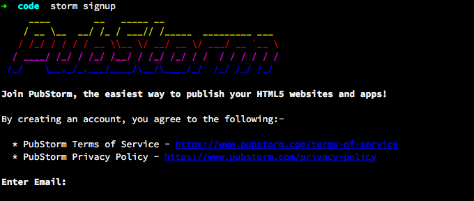

### Name

storm signup - Create a new PubStorm account

### Synopsis

<pre><code>storm signup</code></pre>

### Description

Use `storm signup` to sign up for a [PubStorm](http://www.pubstorm.com/) account.
PubStorm is free to use.

You'll be asked to enter your email address and a password. You'll also be asked
to confirm your email address so check your inbox for an email from us.

<figure>
  
</figure>
