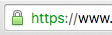

### Name

storm ssl set - Upload an SSL certificate and a private key for a PubStorm
project

### Synopsis

<pre><code>storm ssl set [DOMAIN] [CERT_FILE] [KEY_FILE]</code></pre>

### Arguments

**DOMAIN**: Domain that certificate is for. Specify `default` to disable the
default `.pubstorm.site` domain. _Optional._<br>
**CERT_FILE**: Path to SSL certificate file. _Optional._<br>
**KEY_FILE**: Path to private key for SSL certificate. _Optional._

### Description

Use `storm ssl set` to register an SSL certificate for a custom domain. This
will allow you to secure traffic to your website when it is accessed via your
custom domain.

To do this, you will first need an SSL certificate and its private key for your
custom domain. Place them in a local path so that the `storm` command can access
them.

```bash
$ storm ssl set
Enter Domain Name: help.pubstorm.com
Enter Path To Certificate: /path/to/help.pubstorm.com/cert.pem
Enter Path To Private Key: /path/to/help.pubstorm.com/privkey.pem
[Info] Successfully set an SSL certificate for https://help.pubstorm.com/

Certificate details for domain "help.pubstorm.com":
Common Name: help.pubstorm.com
Issuer: /C=US/O=Let's Encrypt/CN=Let's Encrypt Authority X3
Subject: /CN=help.pubsorm.com
Starts At: 2016-05-09 04:20:00 +0000 UTC
Expires At: 2016-08-07 04:20:00 +0000 UTC
```

You will then be able to access your website over
[HTTPS](https://en.wikipedia.org/wiki/HTTPS) in a web browser,
e.g. _https://yourdomain.com/_.

<figure>
  
</figure>

### See Also

[`storm ssl info`](),
[`storm domains`]()
