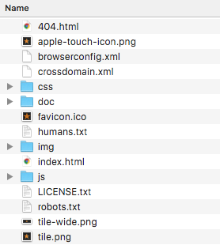
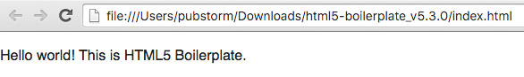

PubStorm is perfect for publishing static HTML websites. In just 4 steps,
you can publish and host your site on PubStorm's cloud.

Let's walk through the entire process so that you get an idea of what PubStorm
can do.

### Steps

1. [Step 1](#step-1-create-your-website): Create your website
2. [Step 2](#step-2-get-pubstorm): Get PubStorm
3. [Step 3](#step-3-create-a-pubstorm-project): Create a PubStorm project
4. [Step 4](#step-4-publish-your-website): Publish your website

### Step 1: Create your website

This is the hardest part - actually creating your website. This is the part
where you'll be writing HTML, CSS and maybe some JavaScript.

We're going to cheat here and use a popular [HTML5 boilerplate](https://html5boilerplate.com/)
in place of actually creating a site. [Download it](https://github.com/h5bp/html5-boilerplate/releases/download/5.3.0/html5-boilerplate_v5.3.0.zip)
to your computer and unzip it.

<figure>
  
</figure>

If you open `index.html` in a web browser, you'll see the site in all its
black and white glory:

<figure>
  
</figure>

It's not a pretty site, but let's just pretend it's yours.

### Step 2: Get PubStorm

Now that your site is ready, it's time to setup PubStorm.

1. Install a recent version of [Node.js](https://nodejs.org/) - get it from the
   [Node.js Download page](https://nodejs.org/en/download/).
2. Install PubStorm using `npm` by running the following in a terminal window:

```bash
$ npm install -g pubstorm
```

<div class="alert warning">
  <strong>Note:</strong> You may need to preface the <code>npm install</code>
  command with <code>sudo</code>, depending on how you've setup Node.js.
</div>
3\. Create a PubStorm account by running [`storm signup`]().
    If you already have an account, login with [`storm login`]().

### Step 3: Create a PubStorm project

Now, let's create a new PubStorm **project** for our site by running
[`storm init`]() at the root directory of
your site's files.

```bash
$ cd /Users/pubstorm/Downloads/html5-boilerplate_v5.3.0
$ storm init
Set up your PubStorm project
Enter Project Path (path to be deployed): [.] .
Enter Project Name: html5-boilerplate
[Info] Successfully created project "html5-boilerplate".
[Info] Saved project settings to "pubstorm.json". This file should not be deleted.
```

This will add `pubstorm.json` file that contains your project's details. You
shouldn't delete it.

### Step 4: Publish your website

All that's left now is to publish your site to PubStorm using
[`storm publish`]().

```bash
$ storm publish
Scanning "/Users/pubstorm/Downloads/html5-boilerplate_v5.3.0"...
[Info] Bundling 25 files (199 kB)...

Packing bundle "html5-boilerplate"...
[========================================] 100.0%

Uploading bundle "html5-boilerplate" to PubStorm Cloud...
[========================================] 100.0%

Launching v1...
[Info] Successfully published "html5-boilerplate" on PubStorm Cloud.
=> html5-boilerplate.pubstorm.site
```

If you go to [http://html5-boilerplate.pubstorm.site/](http://html5-boilerplate.pubstorm.site/),
you'll see that your site is now on the Internet.

### Fin

Yes, that's really it - with PubStorm, it's very easy to publish a site on the
Internet.

Do take [PubStorm](https://www.pubstorm.com/) for a spin - you can get a webpage
up in minutes, so there's really no excuse to not have a homepage for your
pet cat/[shiba inu](https://upload.wikimedia.org/wikipedia/en/5/5f/Original_Doge_meme.jpg)/llama.
