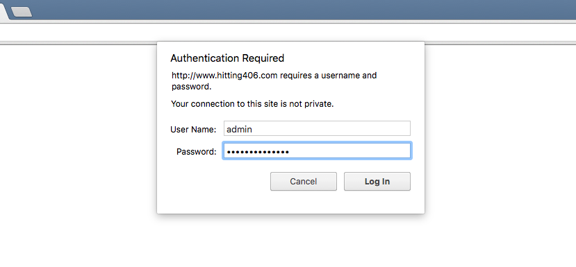

### Name

storm protect - Protect your PubStorm project with HTTP basic authentication

### Synopsis

<pre><code>storm protect [USERNAME] [PASSWORD]</code></pre>

### Arguments

**USERNAME**: HTTP basic authentication username<br>
**PASSWORD**: HTTP basic authentication password

### Description

`storm protect` allows you to protect your project with HTTP basic
authentication. HTTP basic authentication is a method for an HTTP user agent to
provide a user name and password when making a request.

<figure>
  
</figure>

### Examples

##### Add HTTP basic authentication to project

```bash
$ cd /path/to/my/site
$ storm protect
Basic Auth Username: <username>
Basic Auth Password: <password>
[Info] Successfully protected project "<project-name>".
```

### See Also

[`storm unprotect`]()
